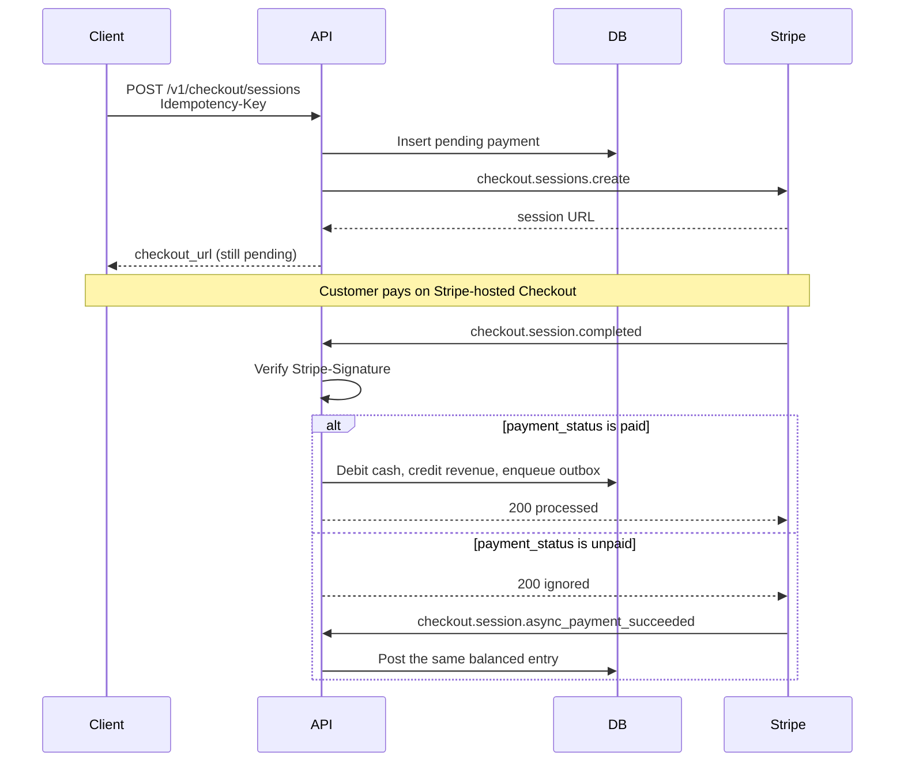
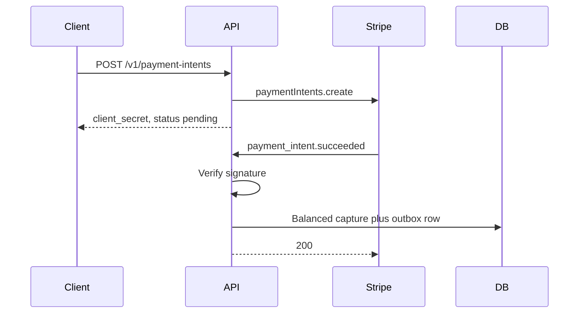
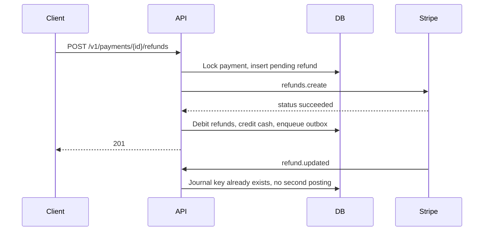
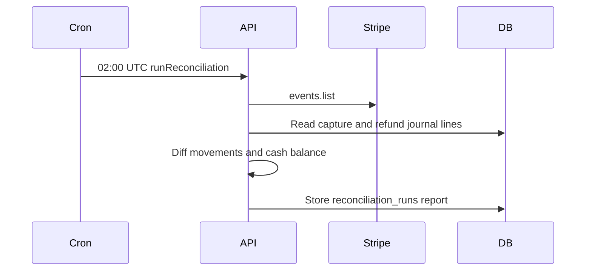

# Payments API

Test-mode payments service for **Arpan Bom**, a senior backend engineer with fintech experience. It accepts a payment with Stripe Checkout or a PaymentIntent, books it in a double-entry ledger when the webhook says the money moved, and reconciles those books against Stripe events.

**This is a portfolio demo. It moves no live money.** The process refuses `sk_live_` / `rk_live_` keys and rejects live-mode webhook events. The default stack uses an in-process fake Stripe gateway, so you can boot it and run the tests with no Stripe account. Point `STRIPE_MODE=test` at a [restricted test key](https://docs.stripe.com/keys.md#manage-your-api-keys) (`rk_test_...`) when you want the real Stripe test mode. A [sandbox](https://docs.stripe.com/sandboxes.md) is the right Stripe test environment for new work; do not put secret keys in source or in git.


## What it shows

- Stripe Checkout Sessions and PaymentIntents on API version `2026-09-30.endive`, instantiated as a client (the Node SDK class is `Stripe`). Dynamic payment methods stay on: requests do not send `payment_method_types`.
- Webhook signature verification before any state change. Fulfillment runs on `checkout.session.completed` and `checkout.session.async_payment_succeeded`, and only when `payment_status` is `paid` or `no_payment_required`. The success URL does not grant anything.
- Idempotency-Key on every create, forwarded to Stripe, with request hashing and replay.
- A Postgres double-entry ledger. Captures debit cash at Stripe and credit revenue. Refunds debit a refunds expense and credit cash. A deferred constraint rejects an unbalanced journal entry.
- An outbox written in the same transaction as the journal entry, published with exponential backoff.
- Refunds, including partial refunds, idempotent with the refund webhook.
- A nightly reconciliation job (02:00 UTC) that diffs Stripe events against ledger movements.
- OpenAPI 3 document at `openapi/openapi.yaml` (also `GET /openapi.json`).

## Ledger

| Event | Debit | Credit |
| --- | --- | --- |
| Payment captured | `cash:stripe:{currency}` (asset) | `revenue:{currency}` (income) |
| Refund posted | `refunds:{currency}` (expense) | `cash:stripe:{currency}` (asset) |

Amounts are integer cents. `GET /v1/ledger/trial-balance` is balanced when total debits equal total credits.

## Checkout

The customer pays on Stripe. The API books the payment only after a verified webhook.



## PaymentIntent

`POST /v1/payment-intents` returns a client secret for a custom confirmation flow. The ledger waits for `payment_intent.succeeded`. `payment_intent.payment_failed` marks the local payment failed and does not post a journal entry.



## Refunds

A refund reserves the remaining balance, calls Stripe, then posts the reversing entry. `refund.updated` posts that same entry again under the journal idempotency key `refund:{id}`, so the webhook and the API cannot double-book.



## Outbox and reconciliation

Domain events (`payment.captured`, `refund.posted`) are inserted in the ledger transaction. A poller publishes them into `published_events`. A failed publish stores the error, increments `attempts`, and sets `next_attempt_at` with exponential backoff and jitter. After 8 attempts the row is left unpublished.

Reconciliation lists Stripe events (`checkout.session.completed`, `checkout.session.async_payment_succeeded`, `payment_intent.succeeded`, `refund.created`, `refund.updated`, `refund.failed`) and compares them to journal movements keyed by PaymentIntent id and Refund id. It also checks that cash-at-Stripe equals captured cents minus refunded cents. The scheduler uses `0 2 * * *` UTC when `ENABLE_SCHEDULER=true`. `npm run reconcile` runs the same job and exits 2 when it finds a discrepancy.



## Run it

```bash
docker compose up --build
curl -s localhost:3000/health
```

Create a Checkout session against the fake gateway:

```bash
curl -s -X POST localhost:3000/v1/checkout/sessions \
  -H 'content-type: application/json' \
  -H 'idempotency-key: demo-checkout-001' \
  -d '{
    "amount_cents": 2500,
    "currency": "usd",
    "description": "Design invoice",
    "success_url": "https://example.com/success",
    "cancel_url": "https://example.com/cancel"
  }'
```

The fake gateway does not contact Stripe. `checkout_url` is a placeholder. To exercise test mode, copy `.env.example`, set `STRIPE_MODE=test`, and provide:

- `STRIPE_API_KEY` — a restricted key (`rk_test_...`) that can write Checkout Sessions, PaymentIntents, and Refunds, and read Events. Prefer that over a secret key (`sk_test_...`).
- `STRIPE_WEBHOOK_SECRET` — from the Stripe CLI or a test-mode webhook endpoint (`whsec_...`).

```bash
stripe listen --forward-to localhost:3000/v1/webhooks/stripe
```

Store those values in the environment or a secrets manager. Do not commit them. The API logs a warning if it is started with a secret key instead of a restricted key.

Drain the outbox or run reconciliation by hand with `X-Job-Token` (compose default: `dev-job-token`):

```bash
curl -s -X POST localhost:3000/v1/jobs/outbox/drain -H 'x-job-token: dev-job-token'
curl -s -X POST localhost:3000/v1/jobs/reconcile -H 'x-job-token: dev-job-token'
```

## Tests

Unit tests cover backoff, journal balance, idempotency hashing, webhook signatures, and the reconciliation diff. Integration tests boot the app with `FakeStripeGateway` and Postgres. They create payments, post signed webhooks (Stripe's own test-header helper, no network), refund, drain the outbox, and reconcile. No Stripe secret is required.

GitHub Actions runs `npm run build` and `npm test` against a Postgres 16 service container. See `.github/workflows/ci.yml`.

```bash
npm ci
npm test   # needs DATABASE_URL pointing at Postgres
```

## API map

| Method | Path | Purpose |
| --- | --- | --- |
| GET | `/health` | Database check |
| GET | `/openapi.json` | OpenAPI document |
| POST | `/v1/checkout/sessions` | Start Checkout |
| POST | `/v1/payment-intents` | Create a PaymentIntent |
| GET | `/v1/payments` | List payments |
| GET | `/v1/payments/{id}` | Fetch a payment |
| GET | `/v1/payments/{id}/journal` | Ledger entries |
| POST | `/v1/payments/{id}/refunds` | Refund |
| GET | `/v1/ledger/trial-balance` | Debits, credits, balances |
| POST | `/v1/webhooks/stripe` | Signed Stripe webhook |
| POST | `/v1/jobs/reconcile` | Ledger vs Stripe events |
| GET | `/v1/reconciliations` | Past runs |
| POST | `/v1/jobs/outbox/drain` | Publish pending events |

## Layout

```
src/                 HTTP app, ledger, outbox, webhooks, reconciliation
db/migrations/       Postgres schema and the balance trigger
openapi/openapi.yaml API contract
tests/unit           pure tests
tests/integration    Postgres + fake Stripe
```
